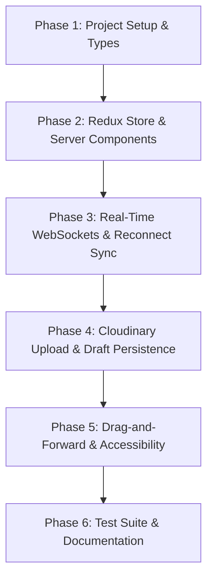

# SimuPhish Sr. Frontend Developer Assessment – Gap Analysis & Migration Plan

## 1. Executive Summary

This document provides a comprehensive technical gap analysis comparing the target requirements of **[SimuPhish_Sr_Frontend_Developer_Assessment.md](file:///c:/Users/SONJIT%20SAHA/OneDrive/Desktop/personal/Devloping/wydChat/SimuPhish_Sr_Frontend_Developer_Assessment.md)** against the existing repositories:
1. **Frontend App:** `wydChat` (Astro 5 + React JSX)
2. **Socket Server:** `wydChat-socketServer` (Node.js + Express + basic Socket.io)

### Key Finding
The target assessment is calibrated for a **Senior-level hire** evaluating architecture, TypeScript rigor, Next.js 14+ App Router rendering paradigms, Redux Toolkit state normalization, resilient WebSockets with reconnect recovery, Cloudinary media pipelines, drag-and-forward interactions with full keyboard accessibility, and a test suite.

The existing `wydChat` codebase provides valuable UX reference implementations (two-pane layout, date grouping, auto-scrolling, typing debouncing, reply previews), but its core tech stack (**Astro + Firebase Firestore + Zustand + Untyped JS**) and socket architecture (**notification-only relay without message persistence or sync**) cannot be directly used as-is.

---

## 2. Detailed Gap Analysis Matrix

| Evaluation Dimension | SimuPhish Assessment Target | Current `wydChat` Codebase | Current `wydChat-socketServer` | Gap Assessment |
| :--- | :--- | :--- | :--- | :--- |
| **Framework & Architecture** | **Next.js 14+ (App Router)** with Server Components vs. Client Components separation | **Astro 5** with `.astro` pages (`index.astro`, `chats.astro`) | Standalone Node.js Express server | 🔴 **Complete Rewrite required to Next.js App Router** |
| **Language & Type Safety** | **Strict TypeScript** throughout; typed WebSocket event contracts; zero unverified `any` | JavaScript (`.js`, `.jsx`), no TypeScript types | Plain JavaScript (`server.js`), untyped payloads | 🔴 **Full TypeScript Migration** |
| **State Management** | **Redux Toolkit** (Normalized state with entity adapters, `createSelector` memoized selectors) | **Zustand** (`useAuthStore.js`) + ad-hoc local `useState` in components | In-memory `users = {}` map | 🔴 **Must build normalized Redux store** |
| **Real-Time Transport** | **WebSockets (Socket.io)** as primary real-time message transport with delivery guarantees | **Firebase Firestore** handles messages (`onSnapshot`); Sockets only emit notifications | Relays notifications; does not store or synchronize message history | 🔴 **Overhaul Socket server & client transport** |
| **Reliability & Reconnects** | Reconnect gap recovery (no lost messages), duplicate prevention, optimistic delivery with acks | Relies on Firebase offline cache; socket has no recovery | Drops messages if receiver socket is not connected | 🔴 **Build Reconnection & Deduplication Engine** |
| **Media Storage** | **Cloudinary** centralized media storage with drag-and-drop, progress bar, error handling | **Google Drive API** (`upload-file.js`) via service account credentials | None | 🔴 **Implement Cloudinary pipeline** |
| **Drag-and-Forward Messages** | Drag text/image/video to forward + smooth transitions + **accessible keyboard alternative** | None (only basic Context Menu reply/edit/delete) | None | 🔴 **Build Drag-and-Forward & A11y flow** |
| **Draft Persistence** | Unsent composer drafts survive full refresh, scoped per conversation | None (`text` is local React state, lost on refresh or navigation) | N/A | 🟡 **Build Per-Conversation Draft Store** |
| **Server-Side Validation** | Authenticated session verification, message length cap, content sanitization, server MIME checks | Client generates message directly into Firestore; no server gatekeeper | Trusts client-supplied `userId` and `receiver` | 🔴 **Build Server-Side Validation layer** |
| **Accessibility (A11y)** | Keyboard alternative for drag-and-forward, ARIA roles, form labels, image alt text | Non-semantic `div` buttons, no keyboard shortcuts or accessible forward | N/A | 🟡 **Implement WCAG 2.1 A11y Standards** |
| **Testing** | Unit tests (selectors, deduplication, sorting) + Component tests (MessageList, Composer) | **0 tests** (no test runner installed) | 0 tests | 🔴 **Setup Vitest / RTL and write test suites** |
| **Animations** | Meaningful motion for message arrival, forwarding, and typing indicators | Basic CSS inline styles and transitions | N/A | 🟡 **Integrate Framer Motion / CSS Keyframes** |

---

## 3. Deep-Dive on Existing Socket Server (`wydChat-socketServer`)

### Current Implementation Overview
Located at `C:\Users\SONJIT SAHA\OneDrive\Desktop\personal\Devloping\wydChat-socketServer\server.js`:
- Uses Express + HTTP + Socket.io 4.8.1.
- In-memory dictionary: `const users = {};` (`users[userId] = socket.id`).
- Handles:
  - `register(userId)`: Binds user ID to socket ID.
  - `sendMessage`: Looks up `receiverSocket` and emits `"notification"`. **It does not emit the message itself to the chat thread!**
  - `typing` / `stopTyping`: Relays typing indicators.
  - WebRTC signaling for Agora voice calls (`incomingCall`, `callAccepted`, etc.).

### Critical Shortcomings for the Senior Assessment:
1. **Not a true message transport:** Messages in `wydChat` bypass the socket server and write directly to Firebase Firestore. The socket only sends a notification ping.
2. **No Authentication Handshake:** Any client can claim any `userId` via `socket.emit("register", id)`.
3. **No Message Persistence or Sequence IDs:** If the recipient is offline or disconnected, the message notification is dropped permanently.
4. **No Reconnection Protocol:** If a socket drops and reconnects, there is no sync event (`sync_messages`) to backfill messages missed during the connection gap.
5. **No Ack Callback:** The sender never receives a server delivery acknowledgment or error state.

---

## 4. Code Reuse Inventory: What to Copy & Adapt

The following files from `wydChat` contain UI patterns and algorithms that should be extracted and converted to TypeScript:

| Source File in `wydChat` | Logic to Extract & Reuse | Adaptation Strategy for SimuPhish |
| :--- | :--- | :--- |
| **`src/hooks/useGroupedMessages.js`** | Message grouping algorithm (clusters consecutive messages from same sender within time window). | Convert to a pure TypeScript utility and create a memoized Redux selector with `createSelector`. |
| **`src/hooks/useScrollToBottom.js`** | Auto-scroll to bottom on incoming messages and height change. | Convert to TypeScript custom hook with threshold detection (don't snap down if user scrolled up to read history). |
| **`src/hooks/useFormattedMessageDate.js`** | Timestamp formatting ("Today at HH:mm", "Yesterday", date strings). | Extract into pure utility functions with comprehensive unit tests. |
| **`src/hooks/useIsTyping.js`** | Debounced typing emission with 1500ms auto-stop timer. | Convert to TypeScript hook wired into typed Socket events and Redux. |
| **`src/components/chat/inputBox/replyPreview.jsx`** | Reply banner UI showing replied-to quote above input box. | Recreate in Tailwind CSS / CSS Modules with dismiss button. |
| **`src/components/chat/filePreview.jsx`** | File attachment preview UI (image thumbnails, generic file cards). | Upgrade to support Cloudinary image/video preview and upload progress ring. |
| **`src/components/chat/chatLayout.jsx`** | Two-column responsive desktop layout (left 25-30% conversation list, right chat thread). | Port to Next.js App Router structure (`app/(chat)/layout.tsx`). |

---

## 5. What Must Be Built from Scratch

### 1. Next.js 14+ App Router Project Foundation
- Initialize with TypeScript (strict mode), ESLint, Tailwind CSS or CSS Modules.
- Clear **Server vs. Client Component** boundary:
  - **Server Components:** `app/(chat)/layout.tsx` (fetches conversations), `app/(chat)/[id]/page.tsx` (fetches initial message history).
  - **Client Components:** `MessageList.tsx` (handles real-time socket events, auto-scroll, virtualized rendering), `Composer.tsx` (drafts, file drops, inputs), `Sidebar.tsx` (drag target for forwarding).

### 2. Normalized Redux Toolkit Store
- Slices:
  - `conversationsSlice`: Conversations entities, active conversation ID.
  - `messagesSlice`: Messages entities keyed by ID using `createEntityAdapter`, indexed by `conversationId`.
  - `draftsSlice`: Persisted per-conversation draft text.
  - `socketSlice`: Connection status, pending offline queue, typing indicators.
- Selectors:
  - `selectActiveConversation`
  - `selectMessagesForActiveConversation` (memoized via `createSelector`)
  - `selectGroupedMessagesForActiveConversation` (memoized via `createSelector`)

### 3. Production WebSocket & Sync Engine
- Typed Socket.io contracts (`ClientToServerEvents`, `ServerToClientEvents`, `InterServerEvents`, `SocketData`).
- Session-based handshake authentication (verifying authenticated user ID).
- Optimistic UI updates with client-generated temporary IDs (`clientTempId`).
- Deduplication via UUID idempotency keys.
- Reconnection sync: Client sends `lastSyncedAt` or `lastSequenceId` on reconnect; server backfills missed messages.

### 4. Drag-and-Forward Interaction with Accessible Alternative
- **Drag & Drop:**
  - HTML5 Draggable messages (text, image, video).
  - Conversations in the sidebar act as drop zones.
  - Visual feedback on drag start, drag enter, and drop.
- **Accessible Alternative (Mandatory in Assessment):**
  - "Forward" action button in message context menu and action bar.
  - Keyboard accessible modal (`Escape` to close, arrow keys to select conversation, `Enter` to forward).

### 5. Centralized Cloudinary Upload Flow
- Next.js Route Handler (`/api/upload`):
  - Server-side MIME validation (`image/png`, `image/jpeg`, `image/webp`, `video/mp4`, etc.).
  - File size cap validation.
  - Cloudinary Node SDK integration using signed credentials.
- Client Component:
  - Drag-and-drop zone directly onto composer / chat viewport.
  - Real-time progress bar (0% - 100%).
  - Error state and retry button.

### 6. Draft Persistence
- Unsent composer input automatically saved to `localStorage` (or Redux with persistence) under `draft_${conversationId}`.
- Automatically restored when opening the conversation or after a full browser refresh.

### 7. Unit & Component Test Suite
- **Unit Tests:**
  - Redux selectors memoization and state derivation.
  - Message grouping and sorting helpers.
  - Deduplication and gap recovery functions.
- **Component Tests:**
  - `MessageList`: loading skeleton, error with retry, empty state, rendering text/image/video.
  - `Composer`: text typing, draft persistence across re-renders, file drop, submission.

---

## 6. Phased Implementation Roadmap

1. **Phase 1: Project Bootstrap & TypeScript Schema**
   - Initialize Next.js 14+ App Router project (`simuphish-chat`).
   - Define strict domain types (`types/chat.ts`, `types/socket.ts`).
2. **Phase 2: Redux Store & App Router Layout**
   - Setup Redux Toolkit with `createEntityAdapter` and `createSelector`.
   - Build App Router Server Components for initial data fetching and Client Components for interaction.
   - Port date grouping and scroll hooks from `wydChat`.
3. **Phase 3: Real-Time WebSocket Infrastructure**
   - Implement production Socket.io server (or upgrade `wydChat-socketServer`) with typed events, authentication, sequence tracking, and sync handler.
   - Connect client socket with optimistic updates, ack callbacks, and reconnect recovery.
4. **Phase 4: Cloudinary Upload & Draft Persistence**
   - Setup `/api/upload` route handler with MIME validation and Cloudinary streaming.
   - Build drag-and-drop file upload with progress bar.
   - Implement per-conversation draft persistence.
5. **Phase 5: Drag-and-Forward & Accessibility**
   - Implement drag-and-drop forward to sidebar conversations.
   - Implement keyboard-accessible forward modal with ARIA compliance.
6. **Phase 6: Testing & Production README**
   - Write unit tests for selectors and deduplication.
   - Write component tests for `MessageList` and `Composer`.
   - Write comprehensive README covering architecture, Redux strategy, WebSocket lifecycle, reliability, A11y, and trade-offs.
